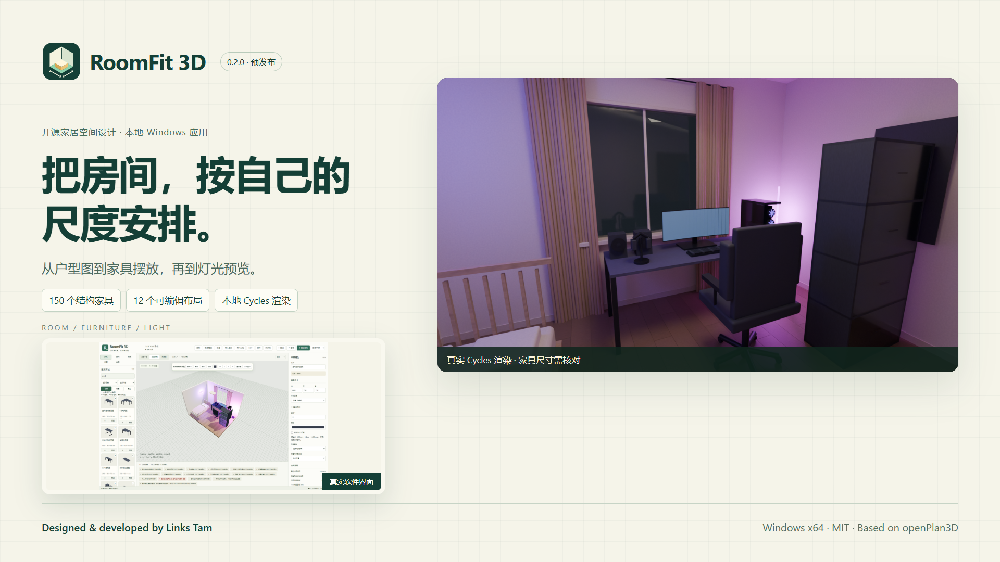
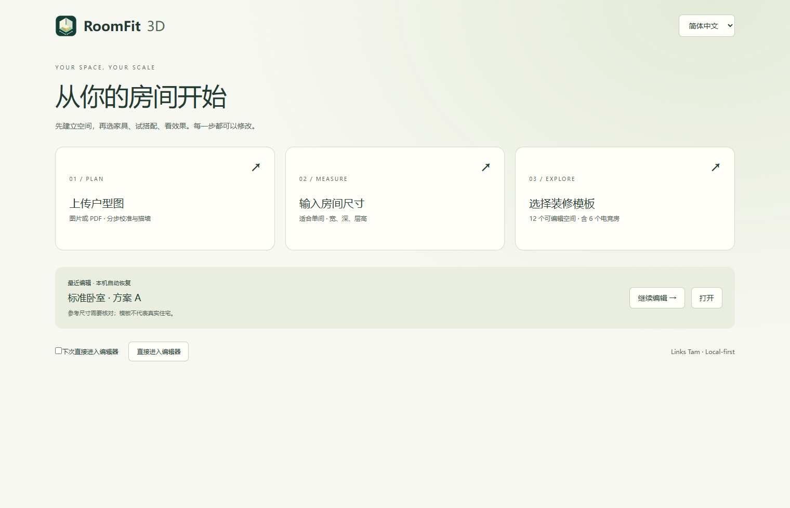

# RoomFit 3D

一款面向普通用户的开源 3D 家居空间与装修模拟软件。由 **Links Tam** 基于 [openPlan3D](https://github.com/laanlabs/openPlan3D) 扩展。

[English](README_EN.md) · [安装](docs/INSTALLATION.md) · [使用](docs/USER_GUIDE.md) · [开发构建](docs/BUILD.md) · [已知限制](docs/KNOWN_LIMITATIONS.md)

**0.2.0 · Windows x64 · 预发布版。** 家具尺寸为可编辑参考值，需要用户核对；本软件不代替现场测量或专业施工图。

## 下载与首次使用

在本仓库右侧 **Releases** 中选择 `v0.2.0`，下载 `RoomFit3D-v0.2.0-Windows-x64-Setup.exe`。安装程序未进行代码签名，可能触发 SmartScreen；请先核对来源和 SHA-256，不要关闭系统防护。当前在 Windows 11 x64 上测试，最低编辑窗口 1100×720；其他 Windows 版本尚未完成验证。

家具与 OCR 数据已随安装包提供，不必另下资源包。普通编辑不需要 Blender；高清渲染需单独安装 Blender（验证版本 4.5.9 LTS），在应用中选择 `blender.exe`。首次打开可上传户型图、输入房间尺寸或选可编辑模板。

## 当前能力

- 本地图片/PDF 导入，五步图纸导入向导、两点尺寸校准、墙线和门窗人工修正。
- 2D/3D 编辑、毫米场景数据、尺寸/旋转、碰撞与净距提示、门扇空间检查、保存和自动恢复。
- **150 个不同结构的通用参数化家具**，其中 45 个电竞类；不是 150 个品牌实测模型，也不以换色重复计数。
- **12 个可编辑布局**，包含 6 个电竞空间；实际模型缩略图、搜索/收藏、家具替换、桌面支撑、RGB 和近似色温。
- 个人家具尺寸与照片记录、受限制的静态纯色 GLB 导入；中英文主工作流。
- 同一场景网格用于 Three.js 预览和本地 Blender Cycles；Windows 桌面文件操作和 PDF 输出。

## 实验与边界

本地 Tesseract OCR 主要读取数字和英文单位；墙体/洞口候选需要确认，不支持完整中文文字识别或自动透视矫正。RoomPlan JSON/ZIP 数据可导入，但本项目**没有交付手机拍摄扫描应用**。GLB 不支持纹理、骨骼、动画或压缩；高级继承编辑器仍有部分英文。碰撞检查有近似，不是施工或通行安全认证。

正在改进/未来方向：更全面的图纸识别、带纹理资产、更完整翻译和实机手机采集验证。这里不把这些方向列为已交付功能。更多限制见 [限制说明](docs/KNOWN_LIMITATIONS.md)。

## 真实画面

| 首页 | 二维户型 |
|---|---|
|  |  |
| 三维房间与家具摆放 | 电竞空间 |
|  |  |

截图来自本次运行的发布副本；渲染来自 0.2.0 的同源网格场景，未使用概念图冒充功能。[媒体来源](docs/media/MEDIA_PROVENANCE.json)。

## 使用流程

创建房间 → 添加家具 → 核对实际尺寸和位置 → 查看碰撞/净距提示 → 预览或调用 Cycles → 保存 `.roomfit`。上传图纸时，先校准尺寸，再修正墙体与门窗。照片是参考记录，不会自动重建家具。

## 开发与验证

详细可复现步骤见 [BUILD.md](docs/BUILD.md)。Node.js 24 x64；在 `app` 中运行 `npm ci`、`npm test -- --maxWorkers=2`、`npm run check`、`npm run build`、`npm run desktop:pack`。开发不需要 Rust；仅渲染 QA 脚本需要 Python 3.12 和 Pillow。完整独立副本的本次结果见 [发布验证](docs/PUBLIC_RELEASE_VALIDATION.md)。

## 与 openPlan3D 的关系

继承其墙体/洞口与房间算法、成熟二维编辑器和其他基础代码；RoomFit 增加独立毫米场景、面向新手的工作流、参数化家具/电竞布局、桌面封装、本地图纸导入辅助和共享网格 Cycles 管线。它不是上游全部功能的替代品，也不保证上游云端、AI 或 iOS 功能在本桌面发行版中可用。记录的基础提交为 `4e66c60c00fba494181d647cc10324becd9a50b5`；来源与本次核对方式见 [版权声明](THIRD_PARTY_NOTICES.md)。

## 许可证与作者

RoomFit 新增代码与图标：MIT，Copyright 2026 **Links Tam**。openPlan3D：MIT，Copyright 2026 theLodgeStudio，原文保留于 `app/LICENSE`。Kenney、ambientCG、OCR 数据、PDF.js 和 npm 依赖分别保留其许可；Blender 是外部独立软件。[完整第三方声明](THIRD_PARTY_NOTICES.md) · [素材许可](docs/ASSET_LICENSES.md)。
