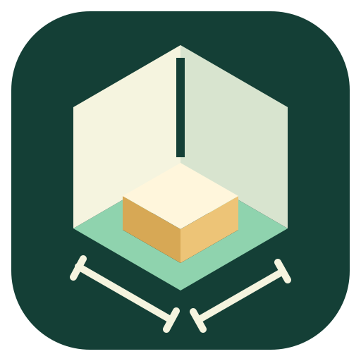
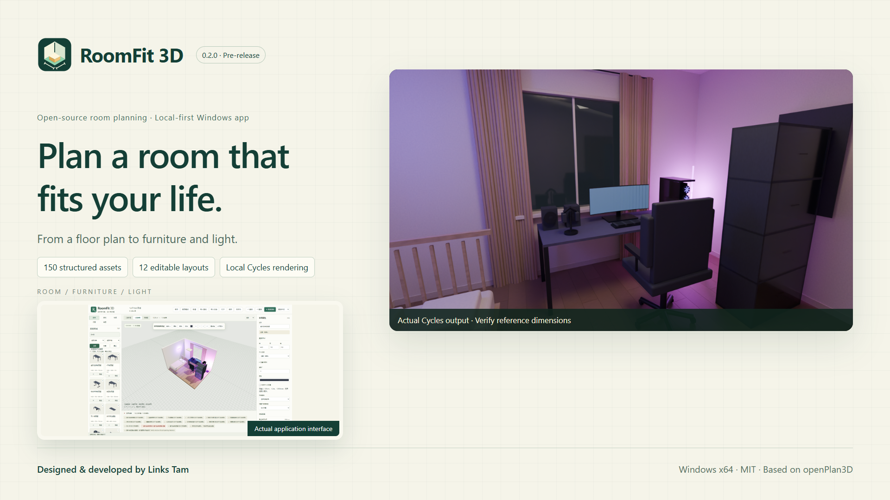
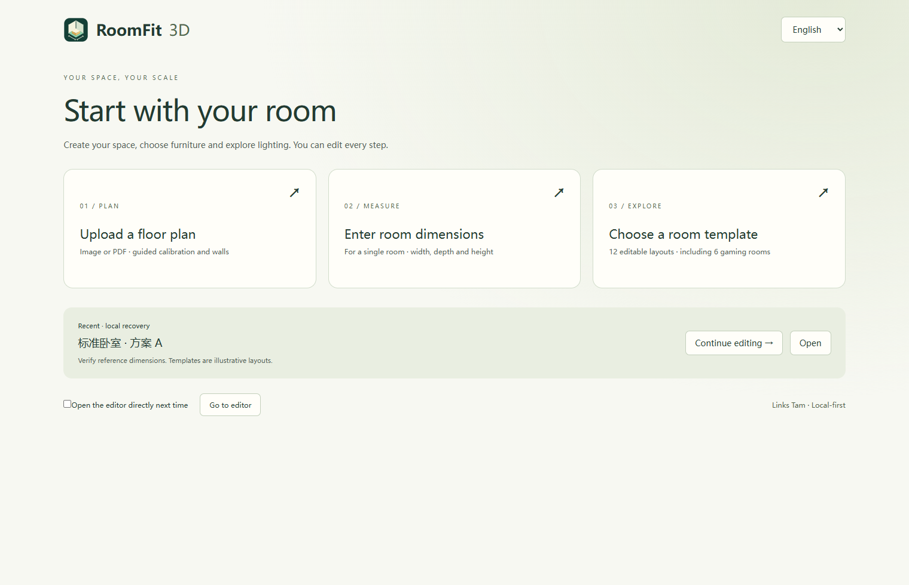
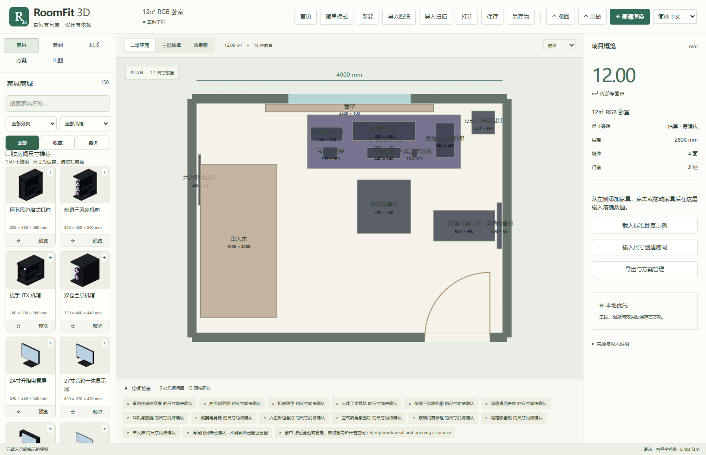
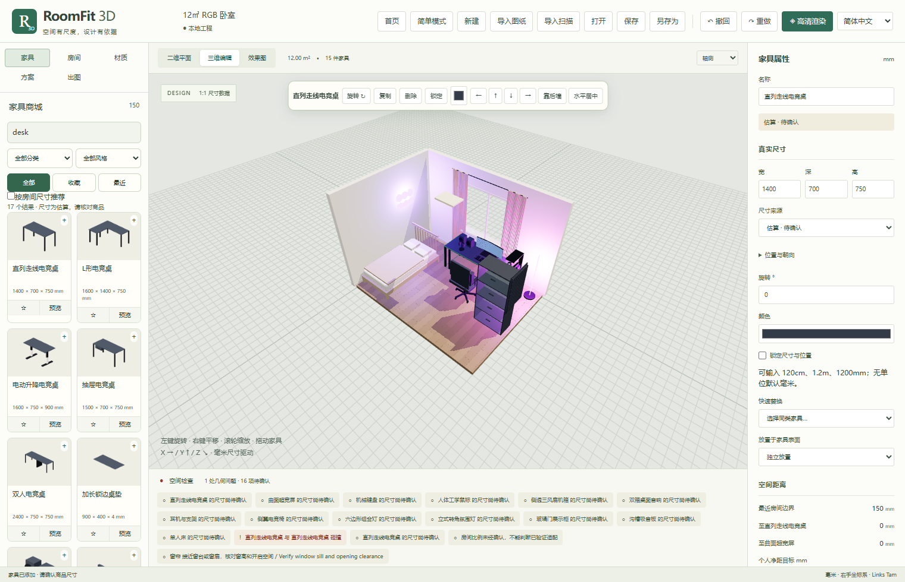
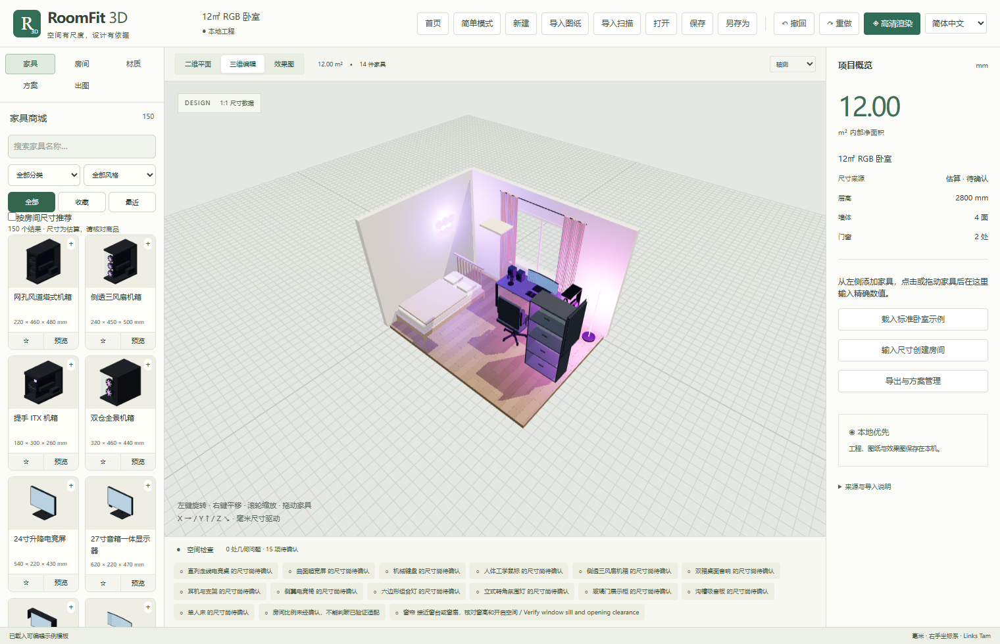
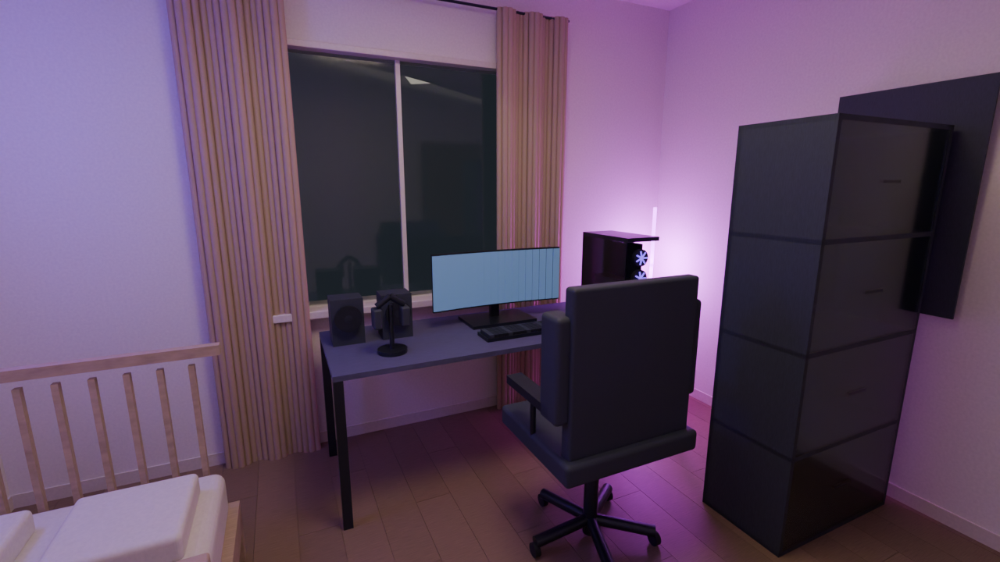

# RoomFit 3D

An open-source room planning and furnishing application for everyday users. Extended from [openPlan3D](https://github.com/laanlabs/openPlan3D) by **Links Tam**.

[简体中文](README.md) · [Installation](docs/INSTALLATION.md) · [Build](docs/BUILD.md) · [Limitations](docs/KNOWN_LIMITATIONS.md)

**0.2.0 · Windows x64 · Pre-release.** Verify reference dimensions against real measurements; this is not a construction drawing or safety certification tool.

## Download

Open this repository’s **Releases**, choose `v0.2.0`, then download `RoomFit3D-v0.2.0-Windows-x64-Setup.exe`. Tested on Windows 11 x64; other Windows versions remain unverified. The unsigned installer may trigger SmartScreen. Verify its source and SHA-256 without disabling system protection.

Furniture and offline OCR resources are included. Editing requires no Blender. High-quality rendering requires a separate Blender installation (tested: 4.5.9 LTS); select its executable in the app. Start with a floor plan, room dimensions, or an editable example.

## Available

- Local image/PDF import, guided scale calibration, editable walls and openings.
- 2D/3D editing, millimetre scene data, dimension/rotation controls, collision and clearance hints, door swing checks, save and recovery.
- 150 structurally distinct generic parametric assets, including 45 gaming items; dimensions are estimates, not manufacturer-certified measurements.
- 12 editable layouts including 6 gaming rooms, real model thumbnails, search/favourites, replacement, support relationships and RGB lights.
- Personal furniture records and limited static solid-material GLB import; Chinese/English main workflows.
- Shared Three.js/Blender Cycles geometry, native Windows file operations and PDF output.

## Experimental and planned

OCR mainly reads digits and Latin units. Wall/opening suggestions require confirmation. Full Chinese OCR, perspective correction and textured/compressed/animated GLB are not supported. RoomPlan JSON/ZIP import is available; a phone capture application is **not delivered**. Some inherited advanced UI remains English. Geometric checks are approximate.

Broader recognition, textured assets, complete translation and physical phone capture validation are future work, not released capabilities. See [limitations](docs/KNOWN_LIMITATIONS.md).

## Actual screenshots

| Home | 2D plan |
|---|---|
|  |  |
| Furniture in 3D | Gaming room |
|  |  |

These are real runtime screenshots and rendered scene geometry, not feature mockups. [Media provenance](docs/media/MEDIA_PROVENANCE.json).

## Workflow and build

Create a room → add furniture → verify dimensions → review geometric hints → preview/render → save `.roomfit`. Floor plan import requires calibration and manual review. Photos are references, not automatic 3D reconstruction.

Node.js 24 x64. In `app`: `npm ci`, `npm test -- --maxWorkers=2`, `npm run check`, `npm run build`, then `npm run desktop:pack`. No Rust toolchain is required. Python 3.12 and Pillow are only needed for render QA scripts. See [build instructions](docs/BUILD.md) and [this copy’s validation](docs/PUBLIC_RELEASE_VALIDATION.md).

## Attribution

RoomFit inherits openPlan3D’s wall/opening/room algorithms and established 2D editor. It adds an independent millimetre scene, beginner workflow, parametric catalogue/gaming layouts, desktop packaging, assisted local floor plan import and shared-geometry Cycles rendering. This is not a superset of upstream cloud, AI or iOS features. The recorded upstream base is `4e66c60c00fba494181d647cc10324becd9a50b5`.

RoomFit additions and branding: MIT, Copyright 2026 **Links Tam**. Upstream: MIT, Copyright 2026 theLodgeStudio, preserved in `app/LICENSE`. Third-party assets and dependencies retain their respective licenses; Blender is a separately installed program. See [notices](THIRD_PARTY_NOTICES.md) and [asset licenses](docs/ASSET_LICENSES.md).
